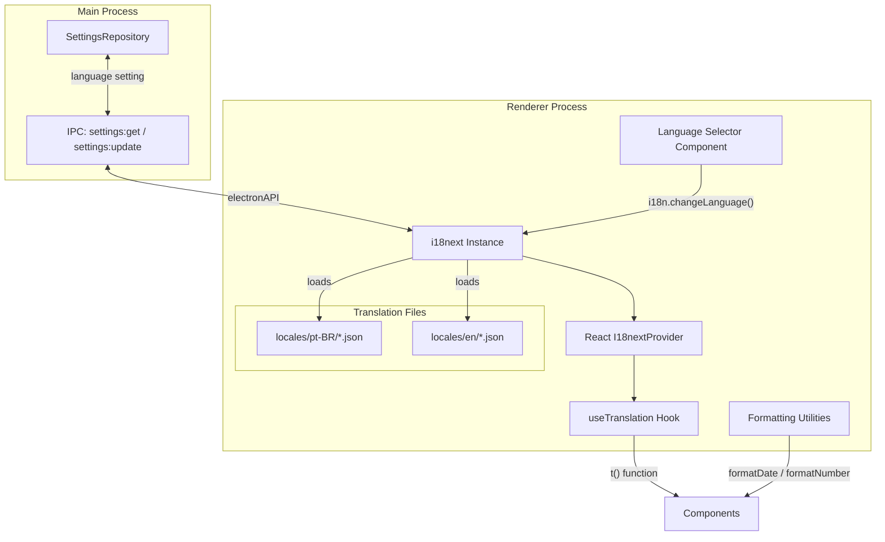
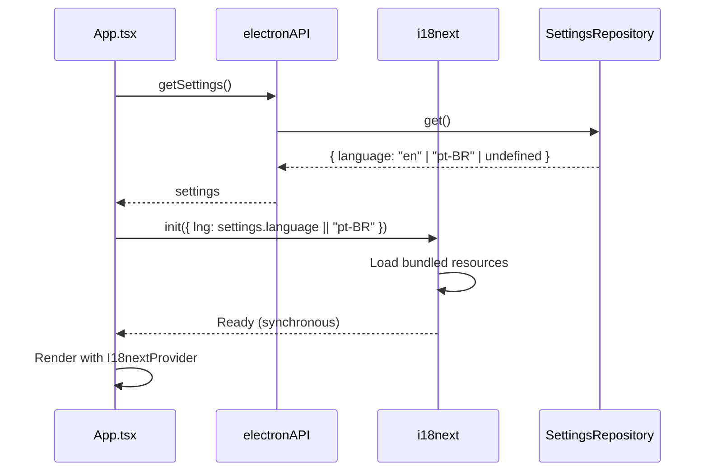

# Design Document: i18n Multi-Language

## Overview

This design adds internationalization (i18n) to SideBrain using **i18next** + **react-i18next**, the de facto standard for React i18n. The system introduces locale-aware translation loading, a `useTranslation` hook for components, live language switching without restart, and locale-sensitive date/number formatting.

The architecture places translation JSON files alongside the renderer source (`src/renderer/locales/{locale}/{namespace}.json`), initializes i18next synchronously with bundled resources to avoid flash-of-untranslated-content (FOUC), and persists the user's language preference via the existing `SettingsRepository`.

### Design Decisions

| Decision | Rationale |
|----------|-----------|
| **i18next + react-i18next** | Industry standard, TypeScript support, built-in interpolation/pluralization, namespace support, large ecosystem |
| **Bundled resources (no HTTP backend)** | Electron app loads from local filesystem; bundled JSON avoids async loading delay and guarantees translations are available before first render |
| **Namespace per feature area** | Keeps translation files small and maintainable; aligns with existing component structure |
| **pt-BR as fallback locale** | Maintains backward compatibility — existing users see zero change |
| **Settings DB for persistence** | Reuses existing `SettingsRepository` pattern; no new storage mechanism needed |
| **Intl API for date/number formatting** | Native browser API, zero-dependency, locale-aware, already available in Electron's Chromium |

## Architecture



### Initialization Flow



## Components and Interfaces

### New Files

| File | Purpose |
|------|---------|
| `src/renderer/i18n/index.ts` | i18next initialization and configuration |
| `src/renderer/i18n/resources.ts` | Imports and aggregates all translation JSON files |
| `src/renderer/locales/pt-BR/common.json` | Common strings (save, cancel, delete, etc.) |
| `src/renderer/locales/pt-BR/dashboard.json` | Dashboard view strings |
| `src/renderer/locales/pt-BR/settings.json` | Settings view strings |
| `src/renderer/locales/pt-BR/capture.json` | Capture input strings |
| `src/renderer/locales/pt-BR/projects.json` | Projects/entries strings |
| `src/renderer/locales/pt-BR/meetings.json` | Meeting mode strings |
| `src/renderer/locales/pt-BR/reports.json` | Reports strings |
| `src/renderer/locales/pt-BR/chat.json` | Smart Chat strings |
| `src/renderer/locales/en/common.json` | English common strings |
| `src/renderer/locales/en/dashboard.json` | English dashboard strings |
| `src/renderer/locales/en/settings.json` | English settings strings |
| `src/renderer/locales/en/capture.json` | English capture strings |
| `src/renderer/locales/en/projects.json` | English projects strings |
| `src/renderer/locales/en/meetings.json` | English meetings strings |
| `src/renderer/locales/en/reports.json` | English reports strings |
| `src/renderer/locales/en/chat.json` | English chat strings |
| `src/renderer/utils/formatting.ts` | Locale-aware date and number formatting utilities |

### Modified Files

| File | Change |
|------|--------|
| `src/shared/types/settings.ts` | Add `language` field to `AppSettings` |
| `src/renderer/main.tsx` | Import i18n config before React render |
| `src/renderer/App.tsx` | Wrap with `I18nextProvider`, load locale from settings |
| `src/renderer/components/Settings.tsx` | Add Language Selector to Appearance tab |
| All renderer components | Replace hardcoded strings with `t()` calls |

### i18next Configuration

```typescript
// src/renderer/i18n/index.ts
import i18n from 'i18next'
import { initReactI18next } from 'react-i18next'
import { resources } from './resources'

const SUPPORTED_LOCALES = ['en', 'pt-BR'] as const
type SupportedLocale = typeof SUPPORTED_LOCALES[number]

export function isValidLocale(value: unknown): value is SupportedLocale {
  return typeof value === 'string' && SUPPORTED_LOCALES.includes(value as SupportedLocale)
}

export function initI18n(locale?: string) {
  const lng: SupportedLocale = isValidLocale(locale) ? locale : 'pt-BR'

  i18n.use(initReactI18next).init({
    resources,
    lng,
    fallbackLng: 'pt-BR',
    supportedLngs: SUPPORTED_LOCALES,
    ns: ['common', 'dashboard', 'settings', 'capture', 'projects', 'meetings', 'reports', 'chat'],
    defaultNS: 'common',
    interpolation: {
      escapeValue: false, // React already escapes
    },
    returnNull: false,
    returnEmptyString: false,
  })

  return i18n
}

export { SUPPORTED_LOCALES }
export type { SupportedLocale }
```

### useTranslation Hook (from react-i18next)

The library provides the hook natively. Components use it as:

```typescript
import { useTranslation } from 'react-i18next'

function MyComponent() {
  const { t, i18n } = useTranslation('dashboard')
  
  return (
    <h1>{t('title')}</h1>
    <p>{t('common:save')}</p> {/* cross-namespace reference */}
    <p>{t('tasks_count', { count: 5 })}</p> {/* pluralization */}
    <p>{t('greeting', { name: userName })}</p> {/* interpolation */}
  )
}
```

### Language Selector Component

```typescript
// Added to Settings.tsx Appearance tab
interface LanguageOption {
  code: SupportedLocale
  nativeName: string
}

const LANGUAGE_OPTIONS: LanguageOption[] = [
  { code: 'pt-BR', nativeName: 'Português (Brasil)' },
  { code: 'en', nativeName: 'English' },
]
```

### Formatting Utilities Interface

```typescript
// src/renderer/utils/formatting.ts
export function formatDate(
  date: Date | string,
  locale: string,
  options?: Intl.DateTimeFormatOptions
): string

export function formatNumber(
  value: number | string,
  locale: string,
  options?: Intl.NumberFormatOptions
): string

export function formatStructuredDate(
  date: Date | string,
  format: 'DD/MM/YYYY' | 'MM/DD/YYYY' | 'YYYY-MM-DD'
): string
```

## Data Models

### AppSettings Extension

```typescript
// Added to src/shared/types/settings.ts
export interface AppSettings {
  // ... existing fields ...
  language: string // 'en' | 'pt-BR' — stored as string for DB compatibility
}

export const DEFAULT_SETTINGS: AppSettings = {
  // ... existing defaults ...
  language: 'pt-BR',
}
```

### Translation File Structure

Each namespace JSON file follows a flat or shallow-nested key-value pattern:

```json
// src/renderer/locales/pt-BR/common.json
{
  "save": "Salvar",
  "cancel": "Cancelar",
  "delete": "Excluir",
  "confirm": "Confirmar",
  "search": "Buscar",
  "loading": "Carregando...",
  "error": "Erro",
  "success": "Sucesso",
  "tasks_one": "{{count}} tarefa",
  "tasks_other": "{{count}} tarefas",
  "greeting": "Olá, {{name}}"
}
```

```json
// src/renderer/locales/en/common.json
{
  "save": "Save",
  "cancel": "Cancel",
  "delete": "Delete",
  "confirm": "Confirm",
  "search": "Search",
  "loading": "Loading...",
  "error": "Error",
  "success": "Success",
  "tasks_one": "{{count}} task",
  "tasks_other": "{{count}} tasks",
  "greeting": "Hello, {{name}}"
}
```

### Resource Bundle Structure

```typescript
// src/renderer/i18n/resources.ts
import ptBRCommon from '../locales/pt-BR/common.json'
import ptBRDashboard from '../locales/pt-BR/dashboard.json'
// ... all pt-BR namespaces

import enCommon from '../locales/en/common.json'
import enDashboard from '../locales/en/dashboard.json'
// ... all en namespaces

export const resources = {
  'pt-BR': {
    common: ptBRCommon,
    dashboard: ptBRDashboard,
    settings: ptBRSettings,
    capture: ptBRCapture,
    projects: ptBRProjects,
    meetings: ptBRMeetings,
    reports: ptBRReports,
    chat: ptBRChat,
  },
  en: {
    common: enCommon,
    dashboard: enDashboard,
    settings: enSettings,
    capture: enCapture,
    projects: enProjects,
    meetings: enMeetings,
    reports: enReports,
    chat: enChat,
  },
} as const
```

## Correctness Properties

*A property is a characteristic or behavior that should hold true across all valid executions of a system — essentially, a formal statement about what the system should do. Properties serve as the bridge between human-readable specifications and machine-verifiable correctness guarantees.*

### Property 1: Locale Persistence Round-Trip

*For any* supported locale value (`en` or `pt-BR`), storing it via settings, then reading it back and initializing i18n, should result in the i18n instance having that exact locale as its active language.

**Validates: Requirements 1.1, 1.3, 1.5, 2.4, 2.5**

### Property 2: Invalid Locale Fallback

*For any* string value that is not `en` or `pt-BR`, when the i18n system initializes with that value as the stored language setting, it should activate `pt-BR` as the active locale and persist `pt-BR` back to the settings store.

**Validates: Requirements 1.6, 2.6**

### Property 3: Translation Key Fallback Chain

*For any* translation key, the resolution follows: (1) if the key exists in the active locale, return its value; (2) if missing in active locale but present in `pt-BR`, return the `pt-BR` value; (3) if missing in both, return the namespace-prefixed key string itself.

**Validates: Requirements 3.3, 3.4, 6.4, 8.5**

### Property 4: Namespace-Qualified Key Resolution

*For any* namespace `ns` and key `k` where `ns:k` exists in the active locale's translation resources, calling `t('ns:k')` should return the exact string value stored in `locales/{locale}/{ns}.json` at key `k`.

**Validates: Requirements 3.6, 8.2**

### Property 5: Interpolation Replacement

*For any* translation string containing N placeholder tokens `{{p1}}, {{p2}}, ..., {{pN}}` (including repeated occurrences) and a corresponding values object providing all N keys, the output should contain each provided value in place of every occurrence of its placeholder, with no remaining `{{...}}` tokens for provided keys.

**Validates: Requirements 4.1, 4.2, 4.4**

### Property 6: Plural Form Selection

*For any* integer count value and a translation key with `_one` and `_other` suffixed variants, calling `t(key, { count })` should return the `_one` variant when count equals 1, and the `_other` variant for all other count values (including 0 and negative numbers).

**Validates: Requirements 5.1, 5.2**

### Property 7: Translation Key Parity Between Locales

*For any* translation key present in the `pt-BR` translation resources across all namespaces, the same key must also exist in the `en` translation resources within the corresponding namespace.

**Validates: Requirements 7.3**

### Property 8: Locale-Aware Number Formatting

*For any* finite number value and supported locale, the `formatNumber` function should produce a string using the locale's decimal separator (`.` for `en`, `,` for `pt-BR`) and thousands separator (`,` for `en`, `.` for `pt-BR`).

**Validates: Requirements 9.1, 9.2**

### Property 9: Explicit Date Format Override

*For any* valid Date and any explicit date format setting (`DD/MM/YYYY`, `MM/DD/YYYY`, or `YYYY-MM-DD`), the `formatStructuredDate` function should produce a string matching the pattern regardless of the active locale.

**Validates: Requirements 9.3**

### Property 10: Invalid Value Passthrough

*For any* string that cannot be parsed as a valid Date, the date formatting function should return the original string unchanged. *For any* non-numeric value passed to the number formatting function, it should return the original value unchanged.

**Validates: Requirements 9.5**

## Error Handling

| Scenario | Behavior |
|----------|----------|
| Invalid locale in DB | Fall back to `pt-BR`, overwrite DB with `pt-BR` |
| Missing translation key (active locale) | Fall back to `pt-BR` value |
| Missing translation key (all locales) | Display raw key string `namespace:key` |
| Translation file fails to parse | Log warning, treat namespace as empty, continue rendering |
| Missing interpolation value | Leave `{{placeholder}}` in output |
| Null/undefined interpolation value | Render empty string |
| Invalid date for formatting | Return original raw string |
| Non-numeric value for number formatting | Return original raw value |
| i18n init failure | Fall back to bundled `pt-BR` resources, show error indicator in Settings |

## Testing Strategy

### Unit Tests (Vitest + @testing-library/react)

- **Settings integration**: Verify language setting CRUD via SettingsRepository
- **Language Selector rendering**: Verify correct options displayed, selection triggers change
- **Component rendering**: Verify key components display translated text for each locale
- **Formatting utilities**: Verify formatDate, formatNumber, formatStructuredDate produce correct output
- **Edge cases**: Missing keys, invalid locales, null interpolation values, malformed JSON handling

### Property-Based Tests (Vitest with fast-check)

- **Library**: `fast-check` — the standard property-based testing library for TypeScript/JavaScript
- **Configuration**: Minimum 100 iterations per property test
- **Tag format**: `Feature: i18n-multi-language, Property {number}: {title}`

Property tests cover:
1. Locale persistence round-trip (store → read → active locale matches)
2. Invalid locale fallback (arbitrary strings → pt-BR)
3. Fallback chain resolution (key present/absent combinations)
4. Namespace:key resolution (generated key lookups match stored values)
5. Interpolation replacement (generated templates + values → no remaining placeholders)
6. Plural form selection (random counts → correct _one/_other suffix)
7. Key parity (iterate all pt-BR keys, assert en key exists)
8. Number formatting separators (random numbers → correct locale separators)
9. Explicit date format override (random dates × 3 format patterns → pattern match)
10. Invalid value passthrough (non-date strings → identity, non-numeric → identity)

### Integration Tests

- **Live switching**: Change locale in Settings, verify all visible components update
- **Startup with persisted locale**: Set locale in DB, reload, verify correct language renders
- **Full UI audit (en)**: Render each view in English, verify no Portuguese strings remain
- **Full UI audit (pt-BR)**: Render each view in Portuguese, verify output matches current hardcoded strings

### What Is NOT Property-Tested

- UI layout/positioning of Language Selector (use example-based render tests)
- 500ms performance threshold for locale switching (use integration timing test)
- Visual flicker during fallback (manual QA)
- Translation content quality/accuracy (manual review)
